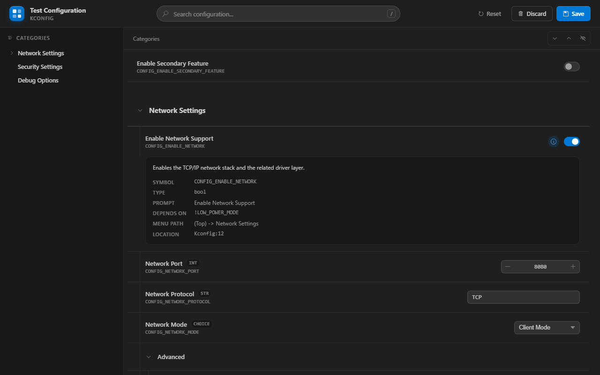
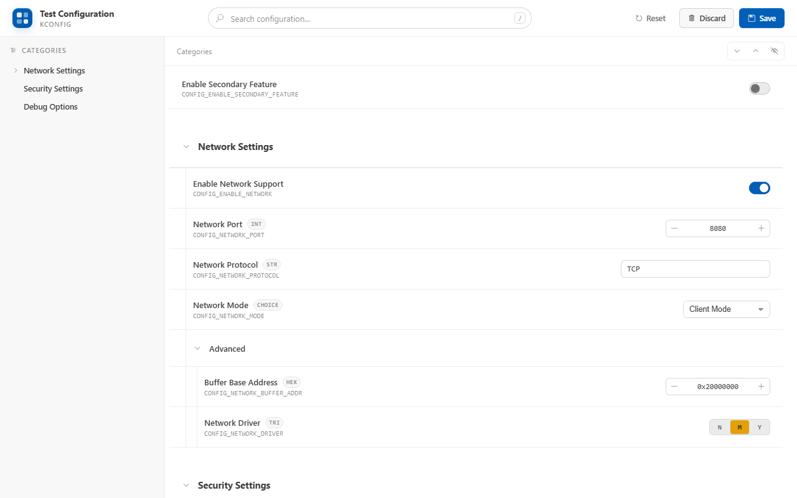

# Kconfig 可视化编辑器 for VSCode

[English](README.md) | **中文**

VSCode Kconfig 可视化编辑器，提供语法高亮、自动补全、验证和可视化菜单配置界面。



支持 2 套 UI 风格，可通过 `kconfig.uiTheme` 设置切换：

1. **现代风格**（默认）：左侧分类侧边栏 + 设置页式的配置项列表



2. **经典风格**：menuconfig 风格的树形导航（`"kconfig.uiTheme": "default"`）


## 功能特性

### 语言支持

- Kconfig 文件语法高亮
- Kconfig 关键字智能自动补全
- 实时语法验证和错误报告
- 支持多种 Kconfig 文件格式（Kconfig、Kconfig.*、.config）
- 常用 Kconfig 结构的代码片段

#### 支持的 Kconfig 语法

**配置定义语句**
- `config` - 定义配置符号
- `menuconfig` - 定义可配置的菜单项
- `choice` - 定义选择组

**数据类型**
- `bool` - 布尔类型
- `tristate` - 三态类型 (y/m/n)
- `string` - 字符串类型
- `int` - 整数类型
- `hex` - 十六进制类型

**控制流程**
- `if...endif` - 条件块
- `menu...endmenu` - 菜单块
- `choice...endchoice` - 选择块
- `optional` - 可选标记

**依赖关系**
- `depends on` - 依赖条件
- `visible if` - 可见性条件
- `select` - 自动选择其他选项
- `imply` - 弱依赖（暗示）

**值设置**
- `default` - 默认值
- `def_bool` - 定义布尔值及默认值
- `def_tristate` - 定义三态值及默认值
- `range` - 数值范围约束

**文件包含与菜单**
- `source` - 包含 Kconfig 文件
- `rsource` - 相对路径包含
- `osource` - 可选包含
- `orsource` - 可选相对路径包含
- `mainmenu` - 主菜单标题
- `comment` - 注释文本

**文本与选项**
- `prompt` - 提示文本
- `help` / `---help---` - 帮助文本块
- `option` - 特殊选项 (defconfig_list, modules, allnoconfig_y)

**表达式与运算符**
- 比较运算符：`=`、`!=`、`<`、`>`、`<=`、`>=`
- 逻辑运算符：`!`、`&&`、`||`
- 括号：`(`、`)`

**常量与值**
- 三态常量：`y` (yes)、`m` (module)、`n` (no)
- 数值：十进制和十六进制（0x 前缀）
- 字符串：双引号字符串，支持转义序列
- 注释：`#` 前缀
- 行续接：`\` 后缀

### 可视化配置编辑器

- 分类侧边栏，可跳转到任意菜单，并高亮当前浏览的分类
- 每个配置项显示提示文本、`CONFIG_` 符号名和类型标签
- 针对不同类型的控件：bool 使用开关，tristate 使用 `N / M / Y` 按钮，int 和 hex 使用 `−`/`+` 步进输入框，choice 使用下拉菜单
- 内联帮助面板，显示帮助文本、依赖、菜单路径和源文件位置
- 按提示文本或符号名搜索（可带或不带 `CONFIG_` 前缀），并实时显示结果数量
- 实时依赖关系解析和验证
- 跟随 VS Code 颜色主题（浅色或深色）
- 保存、丢弃和重置配置更改
- 多语言支持（中文和英文）

## 安装方式

从 VSCode 扩展市场安装，或手动从 .vsix 文件安装。

## 支持的文件类型

### Kconfig 源文件

用于定义配置选项和菜单结构的文件:

- **`Kconfig`** - 主 Kconfig 文件（无扩展名）
- **`Kconfig.*`** - 带任意后缀的 Kconfig 变体文件:
  - `Kconfig.projbuild` - ESP-IDF 项目构建配置
  - `Kconfig.in` - Linux 内核 / Buildroot 包含文件
  - `Kconfig.dev`、`Kconfig.debug` - 自定义 Kconfig 模块
  - 以及任何其他 `Kconfig.*` 模式的文件

### 配置文件

用于存储配置值的文件:

- **`.config`** - 标准 Kconfig 配置输出文件

所有文件类型均支持:
- ✅ 语法高亮
- ✅ 自动补全
- ✅ 实时验证
- ✅ 可视化编辑器（针对 Kconfig 源文件）

## 系统要求

- VSCode 1.60.0 或更高版本

## 扩展设置

本扩展提供以下设置选项：

- `kconfig.enableValidation`: 启用/禁用 Kconfig 文件的语法验证（默认：`true`）
- `kconfig.uiTheme`: 可视化编辑器的 UI 风格，`modern`（现代）或 `default`（经典）（默认：`modern`）
- `kconfig.rtThread.pkgsDir`: 用于解析 RT-Thread 软件包的 `PKGS_DIR` 路径，可自动检测（默认：`~/.env/packages`）


## 使用方法

### 打开 Kconfig 可视化编辑器

1. 右键点击任何 Kconfig 文件
2. 选择 "打开 Kconfig 可视化编辑器"
3. 或者在编辑器标题栏点击配置图标
4. 或者点击活动栏中的 **Kconfig** 图标，或在命令面板中运行 **Kconfig: 打开工作区根目录的 Kconfig**，打开工作区根目录下的 `Kconfig`

### 编辑配置

- 点击左侧边栏中的分类即可跳转；点击菜单标题可展开或折叠
- 按 `/` 聚焦搜索框，按 `Esc` 清除搜索
- 使用开关、`N / M / Y` 按钮、步进输入框、文本框和下拉菜单修改配置值
- 将鼠标悬停在配置项上并点击 ⓘ 按钮，查看帮助和详细信息
- 使用列表上方的工具栏展开全部菜单、折叠全部菜单或关闭所有帮助面板
- 点击 "Save" 保存更改
- 点击 "Discard" 丢弃未保存的更改
- 点击 "Reset" 重置所有配置为默认值

## 编译与安装
1. 克隆仓库：
   ```bash
   git clone https://github.com/ai-embedded/vscode-kconfig-visual-editor.git
   cd vscode-kconfig-visual-editor
    ```
2. 安装依赖并编译：
   ```bash
   npm install
   npm run compile
   ```
3. 打包扩展：
   ```bash
    npx vsce package
   ```

4. 在 VSCode 中安装生成的 `.vsix` 文件：
   ```bash
    code --install-extension kconfig-visual-editor-<version>.vsix
   ```

   或运行 `scripts/reinstall.sh` 一步完成打包和安装。

构建发布版本请运行 `scripts/release.sh`。脚本会显示版本号和警告信息，经确认后运行测试并打包生成 `.vsix` 文件。

## 版本更新记录

1. 0.1.0 - 初始发布，支持基本 Kconfig 语法高亮和自动补全
2. 0.2.0：
    - 新增表格式 Kconfig 可视化编辑器
    - 支持 RT-Thread 环境变量 PKGS_DIR
    - 优化部分 Kconfig 语法显示错误
3. 0.2.1:
   - 修复 choice 保存错误

4. 0.3.0:
   - 优化加载速度，提升大型工程加载显示速度，支持 RT-Thread 大型工程
   - 修复部分 Kconfig 语法兼容性问题

5. 0.5.0:
   - 重新设计现代 UI：分类侧边栏导航、设置页式配置项列表、`N / M / Y` tristate 按钮、内联帮助面板，配色跟随 VS Code 主题
   - 现代 UI 成为默认界面（将 `kconfig.uiTheme` 设为 `default` 可使用经典界面）
   - 新增 Kconfig 活动栏视图和 "打开工作区根目录的 Kconfig" 命令
   - VS Code 启动时恢复 Kconfig 视图不再自动打开编辑器（也不再提示根目录缺少 `Kconfig`）；点击 Kconfig 图标仍会立即打开编辑器
   - 保存时现在只写入 `.config` 和 `.config.old`，与 Python menuconfig 一致；移除了自动生成的 `config.h` 头文件、`kconfig.autoHeaderPath` 设置和 `.kconfig-cache` 会话缓存
   - 修复 Windows 上带通配符的 `source` / `rsource` / `osource` / `orsource`（例如 `source "drivers/*/Kconfig"`）匹配不到任何文件、导致相关配置项缺失的问题

## 测试与验证

本扩展已通过大量实际 Kconfig 文件测试验证，确保兼容性和稳定性。完整的测试用例和示例文件请参见 [测试资源库](./test-kconfig/README_zh.md)。

## 资源

- **GitHub 仓库**：[ai-embedded/vscode-kconfig-visual-editor](https://github.com/ai-embedded/vscode-kconfig-visual-editor)
- **问题反馈**：在 [Issues](https://github.com/ai-embedded/vscode-kconfig-visual-editor/issues) 区提交 Bug 或需求
- **示例与测试集**：[test-kconfig/README_zh.md](./test-kconfig/README_zh.md)

## 反馈与贡献

遇到问题或有改进建议？欢迎：
- **报告问题**: 提交 issue 时请附上相关 Kconfig 文件或复现步骤
- **贡献代码**: 我们欢迎任何形式的 Pull Request
- **完善测试**: 提供更多测试用例帮助我们持续改进

## 许可证

根据 Apache License 2.0 许可

## 致谢

本扩展的开发参考了以下优秀的开源项目：

1. **[Kconfiglib](https://github.com/ulfalizer/Kconfiglib)** - Kconfig 语法兼容性参考
2. **[vscode-esp-idf-extension](https://github.com/espressif/vscode-esp-idf-extension)** - UI 设计参考
3. **[vscode-kconfig](https://github.com/trond-snekvik/vscode-kconfig)** - 语法高亮显示参考

感谢这些项目的作者和贡献者的杰出工作，以及他们对开源社区的贡献。
